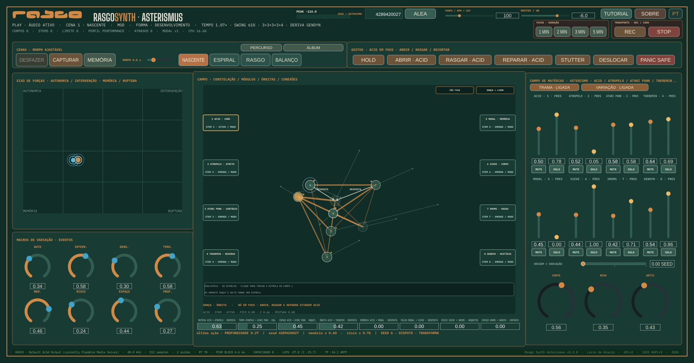

# Rasgo Synth Asterismus

**Website:** [lucioaraujo.github.io/rasgo-synth-asterismus](https://lucioaraujo.github.io/rasgo-synth-asterismus/) ·
**Download:** [v0.3.0](https://github.com/lucioaraujo/rasgo-synth-asterismus/releases/latest) ·
**Contact:** **rasgo.instruments@gmail.com**

Languages:

- [English](#english)
- [Português](#português)
- [Français](#français)
- [Español](#español)

---

## English

**A live instrument in which every synthesis module is a star.** The stars
relate to each other, move by physics, count their own cycles and play. A
seed proposes the sky; the musician plays it, swaps stars, draws relations
and records the piece.

**Authorship:** Lúcio de Araújo · **Family:** [RASGO](https://rasgoinstruments.arquiviagem.net/) ·
**Version:** 0.3.0 · **License:** GNU GPL-3.0-or-later (see
[`LICENSE`](LICENSE), [`CREDITS.md`](CREDITS.md) and
[`THIRD_PARTY_NOTICES.md`](THIRD_PARTY_NOTICES.md))

### What it is

- **A sky of 36 stars**: tone, texture, voice and pulse stars, four of them
  *control* stars that do not sound but filter how the others play. The
  **seed** chooses eight among the 28 of its draw, a key and a mode, a form
  and the cycles: every seed is another piece, and the app always opens
  something new; the other eight come in through the LIBRARY. **LEARN**
  has a fiche for every star.
- **Cuts, tape, filters and sends**: in some parts the sky cuts and wears
  (parenthesis, montage cut, tape stop, spin back, a tape or vinyl layer);
  every star has a filter and echo and hall sends.
- **The web (TRAMA)**: each bar the sky chooses pairs in focus and what each
  pair does — answer, contagion, shadow, hocket, pedal, friction, cadence.
  The piece goes through a form (opening, development, contrast, return) and
  ends with a coda.
- **Time that breathes**: an elastic tempo, a swing that comes from an orbit,
  bars grouped as 3+3+2, a star that drifts against the pulse, eclipses.
- **Physical motion**: in the Constellation the stars move by gravity,
  springs, pendulums, billiards, magnetism, spin and foam; strong collisions
  sound, and each star sounds in the stereo field where it is.

### How you use it

- **PLAY** listens; **ALEA** draws a new seed (or type one).
- In the **Constellation**, click a star to put it in focus and drag it to
  move its place; click a cable to choose its phenomenon and drag it to set
  its strength. The **Axis of Forces** moves eight macros with two points.
- **Gestures** act on the star in focus: OPEN, TEAR, REPAIR, STUTTER,
  DISPLACE, HOLD, PANIC SAFE. Four **scenes** and the **PATH** follow the
  form.
- The **mixer** has one stem per star (presence, level, mute, solo);
  **VARIATION** lets the sky light and dim stars. The **LIBRARY** swaps or
  pins the star of a body.
- **REC** records the take (24-bit stereo WAV, one WAV per body and a JSON
  manifest) into `~/Music/Rasgo Synth Asterismus/recordings/`, one folder
  per take; **TRACK · DURATION** records a piece of 1, 2, 3 or 5 minutes;
  **▶ LISTEN** opens the last take.
- **MEMORY** keeps eight named places; **SAVE SESSION** / **OPEN SESSION**
  write and read `.asterismus` files (parameters only, never audio).

The **TUTORIAL** button explains everything step by step, in English,
Portuguese, French or Spanish.

### Download

Packages for Linux (.deb, .tar.gz), Windows (installer and portable .zip) and
macOS (.dmg) are on the [releases page](https://github.com/lucioaraujo/rasgo-synth-asterismus/releases/latest); installation steps in
[`INSTALL.md`](INSTALL.md).

| Platform | Built and tested | Opened | Played by the author |
|---|---|---|---|
| Linux x86-64 | yes (39 tests) | yes | yes, on real hardware |
| Windows x86-64 | by the release workflow (39 tests) | not yet | not yet |
| macOS (Universal 2) | by the release workflow (39 tests) | not yet | not yet |

Measured on an Intel Core i5-6500 (2015, 4 cores), eight stars, 48 kHz,
512-sample blocks, VARIATION and WEB on: about 1.7 ms of audio work per block
of 10.67 ms (about 16 % of one core); the worst block of 21 seeds (13 minutes)
took 6.7 ms, none above 75 % of the deadline (2026-11-06).

### Build from source

Requirements and steps are in [`INSTALL.md`](INSTALL.md). JUCE 9.0.0 is not
included in this repository. Development notes, in Portuguese, are in
[`DESENVOLVIMENTO.md`](DESENVOLVIMENTO.md) and [`docs/`](docs/); what changed
between versions is in [`CHANGELOG.md`](CHANGELOG.md). The DSP of the stars
comes from the Rasgo Synth Studio, as a pinned copy in `vendor/studio-dsp/`
with its origin and checksums.

---

## Português

**Um instrumento ao vivo em que cada módulo de síntese é uma estrela.** As
estrelas se relacionam, se movem por física, contam os seus próprios ciclos
e tocam. Uma seed propõe o céu; o músico o toca, troca estrelas, desenha
relações e grava a peça.

**Autoria:** Lúcio de Araújo · **Família:** [RASGO](https://rasgoinstruments.arquiviagem.net/) ·
**Versão:** 0.3.0 · **Licença:** GNU GPL-3.0-or-later (ver
[`LICENSE`](LICENSE), [`CREDITS.md`](CREDITS.md) e
[`THIRD_PARTY_NOTICES.md`](THIRD_PARTY_NOTICES.md))

### O que é

- **Um céu de 36 estrelas**: estrelas de tom, textura, voz e pulso, quatro
  delas de *controle*, que não soam mas filtram como as outras tocam. A
  **seed** escolhe oito entre as 28 do seu sorteio, um centro tonal e um
  modo, uma forma e os ciclos: cada seed é outra peça, e o app sempre abre
  algo novo; as outras oito entram pela BIBLIOTECA. O **LEARN** tem uma
  ficha para cada estrela.
- **Cortes, fita, filtros e envios**: em algumas partes o céu corta e se
  gasta (parêntese, corte de montagem, tape stop, spin back, uma camada de
  fita ou de disco); cada estrela tem um filtro e envios de eco e sala.
- **A trama**: a cada compasso o céu escolhe pares em foco e o que cada par
  faz — resposta, contágio, sombra, hoquetus, pedal, atrito, cadência. A
  peça percorre uma forma (abertura, desenvolvimento, contraste, retorno) e
  termina numa coda.
- **O tempo que respira**: andamento elástico, swing que vem de uma órbita,
  compassos agrupados em 3+3+2, uma estrela que deriva contra o pulso,
  eclipses.
- **Movimento físico**: na Constelação as estrelas se movem por gravidade,
  molas, pêndulos, bilhar, magnetismo, efeito e espuma; os choques fortes
  soam, e cada estrela soa no estéreo onde está.

### Como se usa

- **PLAY** toca; **ALEA** sorteia uma seed nova (ou digite uma).
- Na **Constelação**, clique numa estrela para pô-la em foco e arraste-a
  para mudar o seu lugar; clique num cabo para escolher o fenômeno e
  arraste-o para a intensidade. O **Eixo de Forças** move oito macros com
  dois pontos.
- Os **gestos** agem na estrela em foco: ABRIR, RASGAR, REPARAR, STUTTER,
  DESLOCAR, HOLD, PANIC SAFE. Quatro **cenas** e o **PERCURSO** seguem a
  forma.
- O **mixer** tem um stem por estrela (presença, nível, mute, solo); a
  **VARIAÇÃO** deixa o céu acender e apagar estrelas. A **BIBLIOTECA** troca
  ou fixa a estrela de um corpo.
- **REC** grava a tomada (WAV estéreo 24 bits, um WAV por corpo e um
  manifesto JSON) em `~/Music/Rasgo Synth Asterismus/recordings/`, uma
  pasta por tomada; **FAIXA · DURAÇÃO** grava uma peça de 1, 2, 3 ou 5
  minutos; **▶ OUVIR** abre a última tomada.
- A **MEMÓRIA** guarda oito lugares com nome; **SALVAR SESSÃO** / **ABRIR
  SESSÃO** gravam e leem arquivos `.asterismus` (só parâmetros, nunca áudio).

O botão **TUTORIAL** explica tudo passo a passo, em português, inglês,
francês ou espanhol.

### Download

Os pacotes para Linux (.deb, .tar.gz), Windows (instalador e .zip portátil) e
macOS (.dmg) estão na [página de releases](https://github.com/lucioaraujo/rasgo-synth-asterismus/releases/latest); os passos de
instalação, em [`INSTALL.md`](INSTALL.md).

| Plataforma | Compilado e testado | Aberto | Tocado pelo autor |
|---|---|---|---|
| Linux x86-64 | sim (39 testes) | sim | sim, em hardware real |
| Windows x86-64 | pela integração contínua da publicação (39 testes) | ainda não | ainda não |
| macOS (Universal 2) | pela integração contínua da publicação (39 testes) | ainda não | ainda não |

Medido num Intel Core i5-6500 (2015, 4 núcleos), oito estrelas, 48 kHz,
blocos de 512 amostras, VARIAÇÃO e TRAMA ligadas: cerca de 1,7 ms de trabalho
de áudio por bloco de 10,67 ms (cerca de 16 % de um núcleo); o pior bloco em
21 seeds (13 minutos) levou 6,7 ms, nenhum acima de 75 % do prazo (6/11/2026).

### Compilar a partir do código

Requisitos e passos em [`INSTALL.md`](INSTALL.md). O JUCE 9.0.0 não vem
neste repositório. As notas de desenvolvimento estão em
[`DESENVOLVIMENTO.md`](DESENVOLVIMENTO.md) e em [`docs/`](docs/); o que mudou
entre versões, no [`CHANGELOG.md`](CHANGELOG.md). O DSP das estrelas vem do
Rasgo Synth Studio, numa cópia fixada em `vendor/studio-dsp/`, com origem e
checksums.

---

## Français

**Un instrument de scène dans lequel chaque module de synthèse est une
étoile.** Les étoiles se relient, bougent selon la physique, comptent leurs
propres cycles et jouent. Une seed propose le ciel ; le musicien le joue,
échange des étoiles, dessine des relations et enregistre la pièce.

**Auteur :** Lúcio de Araújo · **Famille :** [RASGO](https://rasgoinstruments.arquiviagem.net/) ·
**Version :** 0.3.0 · **Licence :** GNU GPL-3.0-or-later (voir
[`LICENSE`](LICENSE), [`CREDITS.md`](CREDITS.md) et
[`THIRD_PARTY_NOTICES.md`](THIRD_PARTY_NOTICES.md))

### Ce que c'est

- **Un ciel de 36 étoiles** : des étoiles de ton, de texture, de voix et de
  pulsation, dont quatre de *contrôle*, qui ne sonnent pas mais filtrent la
  façon dont les autres jouent. La **seed** en choisit huit parmi les 28 de
  son tirage, une tonalité et un mode, une forme et les cycles : chaque seed
  est une autre pièce, et l'app ouvre toujours du neuf ; les huit autres
  entrent par la BIBLIOTHÈQUE. Le **LEARN** a une fiche pour chaque étoile.
- **Coupes, bande, filtres et envois** : dans certaines parties le ciel coupe
  et s'use (parenthèse, coupe de montage, tape stop, spin back, une couche de
  bande ou de disque) ; chaque étoile a un filtre et des envois d'écho et de
  salle.
- **La trame** : à chaque mesure le ciel choisit des paires en focus et ce
  que fait chaque paire — réponse, contagion, ombre, hoquet, pédale,
  friction, cadence. La pièce parcourt une forme (ouverture, développement,
  contraste, retour) et finit par une coda.
- **Le temps qui respire** : un tempo élastique, un swing qui vient d'une
  orbite, des mesures groupées en 3+3+2, une étoile qui dérive contre la
  pulsation, des éclipses.
- **Mouvement physique** : dans la Constellation les étoiles bougent par
  gravité, ressorts, pendules, billard, magnétisme, effet et mousse ; les
  chocs forts sonnent, et chaque étoile sonne dans la stéréo là où elle est.

### Comment s'en servir

- **PLAY** joue ; **ALEA** tire une nouvelle seed (ou tapez-en une).
- Dans la **Constellation**, cliquez sur une étoile pour la mettre en focus
  et glissez-la pour changer sa place ; cliquez sur un câble pour choisir
  son phénomène et glissez-le pour son intensité. L'**Axe des forces** bouge
  huit macros avec deux points.
- Les **gestes** agissent sur l'étoile en focus : OUVRIR, DÉCHIRER, RÉPARER,
  STUTTER, DÉCALER, HOLD, PANIC SAFE. Quatre **scènes** et le **PARCOURS**
  suivent la forme.
- Le **mixeur** a un stem par étoile (présence, niveau, mute, solo) ; la
  **VARIATION** laisse le ciel allumer et éteindre des étoiles. La
  **BIBLIOTHÈQUE** échange ou épingle l'étoile d'un corps.
- **REC** enregistre la prise (WAV stéréo 24 bits, un WAV par corps et un
  manifeste JSON) dans `~/Music/Rasgo Synth Asterismus/recordings/`, un
  dossier par prise ; **PISTE · DURÉE** enregistre une pièce de 1, 2, 3 ou 5
  minutes ; **▶ ÉCOUTER** ouvre la dernière prise.
- La **MÉMOIRE** garde huit places nommées ; **ENREGISTRER LA SESSION** /
  **OUVRIR UNE SESSION** écrivent et lisent des fichiers `.asterismus`
  (seulement des paramètres, jamais d'audio).

Le bouton **TUTORIEL** explique tout pas à pas, en français, anglais,
portugais ou espagnol.

### Téléchargement

Les paquets pour Linux (.deb, .tar.gz), Windows (installeur et .zip portable)
et macOS (.dmg) sont sur la [page des versions](https://github.com/lucioaraujo/rasgo-synth-asterismus/releases/latest) ; les étapes
d'installation, dans [`INSTALL.md`](INSTALL.md).

| Plateforme | Compilé et testé | Ouvert | Joué par l'auteur |
|---|---|---|---|
| Linux x86-64 | oui (39 tests) | oui | oui, sur du vrai matériel |
| Windows x86-64 | par l'intégration continue de la publication (39 tests) | pas encore | pas encore |
| macOS (Universal 2) | par l'intégration continue de la publication (39 tests) | pas encore | pas encore |

Mesuré sur un Intel Core i5-6500 (2015, 4 cœurs), huit étoiles, 48 kHz,
blocs de 512 échantillons, VARIATION et TRAME actives : environ 1,7 ms de
travail audio par bloc de 10,67 ms (environ 16 % d'un cœur) ; le pire bloc sur
21 seeds (13 minutes) a pris 6,7 ms, aucun au-dessus de 75 % du délai
(6/11/2026).

### Compiler depuis les sources

Prérequis et étapes dans [`INSTALL.md`](INSTALL.md). JUCE 9.0.0 n'est pas
inclus dans ce dépôt. Les notes de développement, en portugais, sont dans
[`DESENVOLVIMENTO.md`](DESENVOLVIMENTO.md) et [`docs/`](docs/) ; ce qui a
changé entre les versions, dans [`CHANGELOG.md`](CHANGELOG.md). Le DSP des
étoiles vient du Rasgo Synth Studio, en copie figée dans `vendor/studio-dsp/`,
avec origine et sommes de contrôle.

---

## Español

**Un instrumento en vivo en el que cada módulo de síntesis es una
estrella.** Las estrellas se relacionan, se mueven por física, cuentan sus
propios ciclos y tocan. Una seed propone el cielo; el músico lo toca,
cambia estrellas, dibuja relaciones y graba la pieza.

**Autoría:** Lúcio de Araújo · **Familia:** [RASGO](https://rasgoinstruments.arquiviagem.net/) ·
**Versión:** 0.3.0 · **Licencia:** GNU GPL-3.0-or-later (ver
[`LICENSE`](LICENSE), [`CREDITS.md`](CREDITS.md) y
[`THIRD_PARTY_NOTICES.md`](THIRD_PARTY_NOTICES.md))

### Qué es

- **Un cielo de 36 estrellas**: estrellas de tono, textura, voz y pulso,
  cuatro de ellas de *control*, que no suenan pero filtran cómo tocan las
  otras. La **seed** elige ocho entre las 28 de su sorteo, una tonalidad y un
  modo, una forma y los ciclos: cada seed es otra pieza, y la app siempre
  abre algo nuevo; las otras ocho entran por la BIBLIOTECA. El **LEARN**
  tiene una ficha para cada estrella.
- **Cortes, cinta, filtros y envíos**: en algunas partes el cielo corta y se
  desgasta (paréntesis, corte de montaje, tape stop, spin back, una capa de
  cinta o de disco); cada estrella tiene un filtro y envíos de eco y sala.
- **La trama**: en cada compás el cielo elige pares en foco y lo que hace
  cada par — respuesta, contagio, sombra, hoquetus, pedal, fricción,
  cadencia. La pieza recorre una forma (apertura, desarrollo, contraste,
  retorno) y termina en una coda.
- **El tiempo que respira**: un tempo elástico, un swing que viene de una
  órbita, compases agrupados en 3+3+2, una estrella que deriva contra el
  pulso, eclipses.
- **Movimiento físico**: en la Constelación las estrellas se mueven por
  gravedad, resortes, péndulos, billar, magnetismo, efecto y espuma; los
  choques fuertes suenan, y cada estrella suena en el estéreo donde está.

### Cómo se usa

- **PLAY** toca; **ALEA** sortea una seed nueva (o escriba una).
- En la **Constelación**, haga clic en una estrella para ponerla en foco y
  arrástrela para cambiar su lugar; haga clic en un cable para elegir su
  fenómeno y arrástrelo para su intensidad. El **Eje de fuerzas** mueve ocho
  macros con dos puntos.
- Los **gestos** actúan sobre la estrella en foco: ABRIR, RASGAR, REPARAR,
  STUTTER, DESPLAZAR, HOLD, PANIC SAFE. Cuatro **escenas** y el
  **RECORRIDO** siguen la forma.
- El **mezclador** tiene un stem por estrella (presencia, nivel, mute,
  solo); la **VARIACIÓN** deja que el cielo encienda y apague estrellas. La
  **BIBLIOTECA** cambia o fija la estrella de un cuerpo.
- **REC** graba la toma (WAV estéreo de 24 bits, un WAV por cuerpo y un
  manifiesto JSON) en `~/Music/Rasgo Synth Asterismus/recordings/`, una
  carpeta por toma; **PISTA · DURACIÓN** graba una pieza de 1, 2, 3 o 5
  minutos; **▶ ESCUCHAR** abre la última toma.
- La **MEMORIA** guarda ocho lugares con nombre; **GUARDAR SESIÓN** /
  **ABRIR SESIÓN** escriben y leen archivos `.asterismus` (solo parámetros,
  nunca audio).

El botón **TUTORIAL** lo explica todo paso a paso, en español, inglés,
portugués o francés.

### Descarga

Los paquetes para Linux (.deb, .tar.gz), Windows (instalador y .zip portátil)
y macOS (.dmg) están en la [página de versiones](https://github.com/lucioaraujo/rasgo-synth-asterismus/releases/latest); los pasos
de instalación, en [`INSTALL.md`](INSTALL.md).

| Plataforma | Compilado y probado | Abierto | Tocado por el autor |
|---|---|---|---|
| Linux x86-64 | sí (39 pruebas) | sí | sí, en hardware real |
| Windows x86-64 | por la integración continua de la publicación (39 pruebas) | todavía no | todavía no |
| macOS (Universal 2) | por la integración continua de la publicación (39 pruebas) | todavía no | todavía no |

Medido en un Intel Core i5-6500 (2015, 4 núcleos), ocho estrellas, 48 kHz,
bloques de 512 muestras, VARIACIÓN y TRAMA activas: cerca de 1,7 ms de trabajo
de audio por bloque de 10,67 ms (cerca del 16 % de un núcleo); el peor bloque
en 21 seeds (13 minutos) tardó 6,7 ms, ninguno por encima del 75 % del plazo
(6/11/2026).

### Compilar desde el código

Requisitos y pasos en [`INSTALL.md`](INSTALL.md). JUCE 9.0.0 no se incluye en
este repositorio. Las notas de desarrollo, en portugués, están en
[`DESENVOLVIMENTO.md`](DESENVOLVIMENTO.md) y [`docs/`](docs/); lo que cambió
entre versiones, en [`CHANGELOG.md`](CHANGELOG.md). El DSP de las estrellas
viene del Rasgo Synth Studio, como copia fijada en `vendor/studio-dsp/`, con
origen y sumas de verificación.
